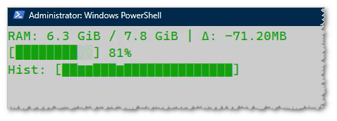
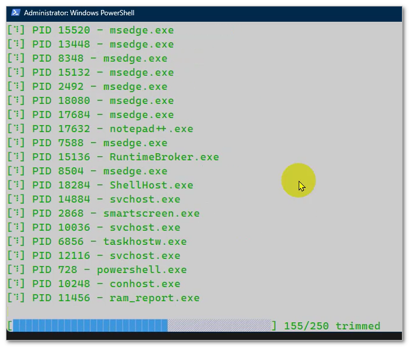
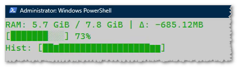

# ram_report

physical memory. 

- text. used/free/total + delta of used memory. human-readable sizes.
- charts. used/free/total percentage + histogram that shows changes in few last minutes.
- Windows users have an additional 'free RAM' functionality that really works!

click: 
- <kbd>r</kbd> to reset the delta reference to "right now".
- <kbd>w</kbd> for Windows users. it trims the memory of all running applications.
- <kbd>q</kbd>|<kbd>x</kbd>|<kbd>ESC</kbd>|<kbd>CTRL</kbd>+<kbd>C</kbd> to quit.

### Windows users - trim functionality.

  

<kbd>w</kbd> queries all running applications,  
for each one it launches a Windows API call from `psapi.dll` (already exists in your Windows installation),  
then goes back to the RAM report screen.
the switching is very fast.
it takes few seconds to see any difference,  
very similar to an old (OLD!) program named `FreeRAM-XP-Pro`,  
it is also uses `EmptyWorkingSet` - https://learn.microsoft.com/en-us/windows/win32/api/psapi/nf-psapi-emptyworkingset  
it is described as "Removes as many pages as possible from the working set of the specified process."  
there are other options (not used) as `SetProcessWorkingSetSize` - https://learn.microsoft.com/en-us/windows/win32/api/memoryapi/nf-memoryapi-setprocessworkingsetsize  
with the `dwMinimumWorkingSetSize` and `dwMaximumWorkingSetSize` parameters set to the value `(SIZE_T)(-1)` .  

  

  

  

I actually needed this to monitor loading of a huge file into RAM.  
the "zero"/"reset" was the functionality I was looking for,  
since it would allow me to see how much memory change there would be at some points in time.  

binaries available to download for multiple OS and CPU architectures.  

### download (direct URLs - latest release)

#### Windows
- [  x86_64-pc-windows-msvc.zip](https://github.com/eladkarako/ram_report/releases/latest/download/x86_64-pc-windows-msvc.zip)
- [  aarch64-pc-windows-msvc.zip](https://github.com/eladkarako/ram_report/releases/latest/download/aarch64-pc-windows-msvc.zip)
- [  i686-pc-windows-msvc.zip](https://github.com/eladkarako/ram_report/releases/latest/download/i686-pc-windows-msvc.zip)

#### Android (NDK `v30.0.16248370`, SDK `v21`)
- [  aarch64-linux-android.zip](https://github.com/eladkarako/ram_report/releases/latest/download/aarch64-linux-android.zip)
- [  armv7-linux-androideabi.zip](https://github.com/eladkarako/ram_report/releases/latest/download/armv7-linux-androideabi.zip)
- [  x86_64-linux-android.zip](https://github.com/eladkarako/ram_report/releases/latest/download/x86_64-linux-android.zip)
- [  i686-linux-android.zip](https://github.com/eladkarako/ram_report/releases/latest/download/i686-linux-android.zip)

#### Linux (gnu)
- [  x86_64-unknown-linux-gnu.zip](https://github.com/eladkarako/ram_report/releases/latest/download/x86_64-unknown-linux-gnu.zip)
- [  i686-unknown-linux-gnu.zip](https://github.com/eladkarako/ram_report/releases/latest/download/i686-unknown-linux-gnu.zip)
- [  aarch64-unknown-linux-gnu.zip](https://github.com/eladkarako/ram_report/releases/latest/download/aarch64-unknown-linux-gnu.zip)
- [  armv7-unknown-linux-gnueabi.zip](https://github.com/eladkarako/ram_report/releases/latest/download/armv7-unknown-linux-gnueabi.zip)
- [  armv7-unknown-linux-gnueabihf.zip](https://github.com/eladkarako/ram_report/releases/latest/download/armv7-unknown-linux-gnueabihf.zip)

#### Linux (musl)
- [  x86_64-unknown-linux-musl.zip](https://github.com/eladkarako/ram_report/releases/latest/download/x86_64-unknown-linux-musl.zip)
- [  i686-unknown-linux-musl.zip](https://github.com/eladkarako/ram_report/releases/latest/download/i686-unknown-linux-musl.zip)
- [  aarch64-unknown-linux-musl.zip](https://github.com/eladkarako/ram_report/releases/latest/download/aarch64-unknown-linux-musl.zip)
- [  armv7-unknown-linux-musleabi.zip](https://github.com/eladkarako/ram_report/releases/latest/download/armv7-unknown-linux-musleabi.zip)
- [  armv7-unknown-linux-musleabihf.zip](https://github.com/eladkarako/ram_report/releases/latest/download/armv7-unknown-linux-musleabihf.zip)

### other
- [changelog.txt](https://github.com/eladkarako/ram_report/releases/latest/download/changelog.txt)
- [version.txt](https://github.com/eladkarako/ram_report/releases/latest/download/version.txt)

### build

- Windows builds uses MSVC.
- Android uses https://dl.google.com/android/repository/android-ndk-r30-linux.zip
- Linux uses various llvm from https://github.com/cross-tools/clang-cross for example `/releases/latest/download/aarch64-unknown-linux-gnu.tar.xz`
- advised `rustup update`, `cargo update`, `cargo clean` once before.
- note: `.cargo/config.toml` includes explicitly the paths to `linker` and `ar` for each target, as well as `CC_` and `AR_` for building C code might be used from any crate. no need to install complex apt packages such as `sudo apt-get update && sudo apt-get upgrade && sudo apt-get install --yes android-sdk-libsparse-utils apt-fast apt-transport-https aptitude aria2 asciidoc autoconf automake autopoint autotools-dev base-files bash bash-completion binutils binutils-aarch64-linux-gnu binutils-aarch64-linux-gnu-dbg binutils-alpha-linux-gnu binutils-alpha-linux-gnu-dbg binutils-arc-linux-gnu binutils-arc-linux-gnu-dbg binutils-arm-linux-gnueabi binutils-arm-linux-gnueabi-dbg binutils-arm-linux-gnueabihf binutils-arm-linux-gnueabihf-dbg binutils-arm-none-eabi binutils-avr binutils-bpf binutils-common binutils-dev binutils-djgpp binutils-doc binutils-for-build binutils-for-host binutils-h8300-hms binutils-hppa64-linux-gnu binutils-hppa64-linux-gnu-dbg binutils-hppa-linux-gnu binutils-hppa-linux-gnu-dbg binutils-i686-gnu binutils-i686-gnu-dbg binutils-i686-kfreebsd-gnu binutils-i686-kfreebsd-gnu-dbg binutils-i686-linux-gnu binutils-i686-linux-gnu-dbg binutils-ia64-linux-gnu binutils-ia64-linux-gnu-dbg binutils-loongarch64-linux-gnu binutils-loongarch64-linux-gnu-dbg binutils-m68hc1x binutils-m68k-linux-gnu binutils-m68k-linux-gnu-dbg binutils-mingw-w64 binutils-mingw-w64-i686 binutils-mingw-w64-x86-64 binutils-mips64-linux-gnuabi64 binutils-mips64-linux-gnuabi64-dbg binutils-mips64-linux-gnuabin32 binutils-mips64-linux-gnuabin32-dbg binutils-mips64el-linux-gnuabi64 binutils-mips64el-linux-gnuabi64-dbg binutils-mips64el-linux-gnuabin32 binutils-mips64el-linux-gnuabin32-dbg binutils-mips-linux-gnu binutils-mips-linux-gnu-dbg binutils-mipsel-linux-gnu binutils-mipsel-linux-gnu-dbg binutils-mipsisa32r6-linux-gnu binutils-mipsisa32r6-linux-gnu-dbg binutils-mipsisa32r6el-linux-gnu binutils-mipsisa32r6el-linux-gnu-dbg binutils-mipsisa64r6-linux-gnuabi64 binutils-mipsisa64r6-linux-gnuabi64-dbg binutils-mipsisa64r6-linux-gnuabin32 binutils-mipsisa64r6-linux-gnuabin32-dbg binutils-mipsisa64r6el-linux-gnuabi64 binutils-mipsisa64r6el-linux-gnuabi64-dbg binutils-mipsisa64r6el-linux-gnuabin32 binutils-mipsisa64r6el-linux-gnuabin32-dbg binutils-msp430 binutils-multiarch binutils-multiarch-dbg binutils-multiarch-dev binutils-or1k-elf binutils-powerpc64-linux-gnu binutils-powerpc64-linux-gnu-dbg binutils-powerpc64le-linux-gnu binutils-powerpc64le-linux-gnu-dbg binutils-powerpc-linux-gnu binutils-powerpc-linux-gnu-dbg binutils-riscv64-linux-gnu binutils-riscv64-linux-gnu-dbg binutils-riscv64-unknown-elf binutils-s390x-linux-gnu binutils-s390x-linux-gnu-dbg binutils-sh4-linux-gnu binutils-sh4-linux-gnu-dbg binutils-sh-elf binutils-source binutils-sparc64-linux-gnu binutils-sparc64-linux-gnu-dbg binutils-x86-64-gnu binutils-x86-64-gnu-dbg binutils-x86-64-kfreebsd-gnu binutils-x86-64-kfreebsd-gnu-dbg binutils-x86-64-linux-gnu binutils-x86-64-linux-gnu-dbg binutils-x86-64-linux-gnux32 binutils-x86-64-linux-gnux32-dbg binutils-xtensa-lx106 binutils-z80 binwalk bison bsdutils build-essential ca-certificates ccache checkinstall clang clisp-module-zlib cmake cmake-curses-gui cmake-data cmake-doc cmake-extras cmake-fedora cmake-format cmake-qt-gui cmake-vala coreutils curl dash debianutils devscripts dh-autoreconf diffutils docbook2x docbook-xsl docker.io dos2unix doxygen doxygen2man doxygen-awesome-css doxygen-doc doxygen-doxyparse doxygen-gui doxygen-latex dpkg-dev dpkg-dev-el elpa-dpkg-dev-el erlang-p1-zlib erofs-utils erofsfuse expat f2fs-tools findutils flex fuse2fs g++ g++-mingw-w64 g++-mingw-w64-i686 g++-mingw-w64-x86-64 gambas3-gb-compress-bzlib2 gambas3-gb-compress-zlib gcc gcc-14-arm-linux-gnueabi gcc-14-arm-linux-gnueabi-base gcc-14-arm-linux-gnueabihf gcc-14-arm-linux-gnueabihf-base gcc-aarch64-linux-gnu gcc-arm-linux-gnueabihf gcc-i686-linux-gnu gcc-mingw-w64 gcc-mingw-w64-i686 gcc-mingw-w64-x86-64 gcc-powerpc64-linux-gnu gcc-powerpc64le-linux-gnu gcc-powerpc-linux-gnu gcc-riscv64-linux-gnu gdb-mingw-w64 gedit gettext gfortran-mingw-w64 git glibc-doc glibc-doc-reference glibc-source glibc-tools gnat-mingw-w64 gnome-terminal gobjc-mingw-w64 gobjc++-mingw-w64 golang gperf grep gtk-doc-tools guile-lzlib guile-zlib gyp gzip hostname init intltool libassuan-mingw-w64-dev libattr1 libc6-armhf-cross libc6-dev libc6-dev-amd64-cross libc6-dev-amd64-i386-cross libc6-dev-amd64-x32-cross libc6-dev-arm64-cross libc6-dev-armhf-cross libc6-dev-i386 libc6-dev-powerpc-cross libc6-dev-powerpc-ppc64-cross libc6-dev-riscv64-cross libc-ares-dev libc++1 libc++abi1 libcompress-raw-zlib-perl libcppunit-dev libcurl4-openssl-dev libdpkg-dev libdwarf-dev libelf-dev libevent-2.1-7t64 libevent-core-2.1-7t64 libevent-dev libevent-distributor-perl libevent-execflow-perl libevent-extra-2.1-7t64 libevent-openssl-2.1-7t64 libevent-perl libevent-pthreads-2.1-7t64 libevent-rpc-perl libexpat1-dev libexpat-ocaml libexpat-ocaml-dev libffi-dev libfuse3-dev libgcc-14-dev-armhf-cross libgcrypt20-dev libgcrypt-mingw-w64-dev libghc-bzlib-dev libghc-bzlib-doc libghc-bzlib-prof libghc-zlib-bindings-dev libghc-zlib-bindings-doc libghc-zlib-bindings-prof libghc-zlib-dev libghc-zlib-doc libghc-zlib-prof libgmp-dev libgnatcoll-zlib3 libgnatcoll-zlib-dev libgnutls28-dev libgpg-error-mingw-w64-dev libguestfs-tools libjansson-dev libjzlib-java libksba-mingw-w64-dev libmpc-dev libmpfr-dev libncurses-dev libnpth-mingw-w64-dev libp11-kit-dev librte-compress-zlib24 libruby3.2 librust-async-compression-dev librust-expat-sys-dev librust-flate2-dev librust-gix-features-dev librust-grcov-dev librust-harfbuzz-sys-dev librust-khronos-egl-dev librust-libsodium-sys-dev librust-libsqlite3-sys-dev librust-libz-sys-dev librust-oxrocksdb-sys-dev librust-pkg-config-dev librust-pq-sys-dev librust-smithay-client-toolkit-dev librust-zip-dev librust-zstd-dev librust-zstd-safe-dev librust-zstd-sys-dev libsgmls-perl libsqlite3-dev libssh2-1-dev libssl-dev libtasn1-6-dev libtool libtool-bin libudev-dev libunistring-dev libxml2-dev libxml-sax-expat-incremental-perl libxml-sax-expatxs-perl libz-mingw-w64 libz-mingw-w64-dev lld llvm-dev login lua-expat lua-expat-dev lua-zlib lua-zlib-dev lzip m4 make mercurial mingw-w64 mingw-w64-common mingw-w64-i686-dev mingw-w64-tools mingw-w64-x86-64-dev musl musl-dev musl-tools nasm nautilus ncurses-base ncurses-bin nettle-dev ninja-build node-browserify-zlib npm openjdk-17-jdk openssh-server p7zip-full p11-kit-doc patch perl pkg-config pkgconf plocate pv python3 python3-colcon-pkg-config python3-docutils python3-jsonschema python3-mako python3-mesonpy python3-pip python3-requests python3-rstr python3-sphinx python-is-python3 r-bioc-zlibbioc ragel re2c ruby-pkg-config screen sed sgml-base sgml-base-doc sgml-data sgml-spell-checker sgmls-doc sgmlspl slang-expat software-properties-common subversion texinfo tree ubuntu-minimal ubuntu-wsl unzip util-linux uuid-dev wget win-iconv-mingw-w64-dev xmlto xsltproc yasm zlib1g-dev`

### note

a free, open-source program, with the assist of GitHub's Copilot,  
Claude Haiku 4.5, Concept art and infographics were generated based on the code and this `README.md` using GPT Image 2.  
written in Rust with JetBrains RustRover IDE with Community license.  

  

 

feel free to suggest fixes, open a bug, test it.

  

 
 
 

<a href="https://paypal.me/31adkarak0" target="_blank" rel="noopener noreferrer">
  
   
  
   
  
</a>

 

 

